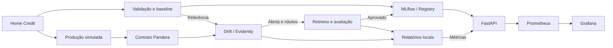

# Credit Monitoring — FIAP Tech Challenge Fase 4

[](https://github.com/jrrrtricolor/FIAP-fase4-fintech/actions/workflows/ci.yml)

Sistema acadêmico de monitoramento de um modelo de risco de crédito. O projeto
valida os dados, simula mudanças de comportamento, identifica drift e treina um
candidato quando há alertas. O foco é a sustentação e a confiabilidade do modelo.

> O retreino não garante melhora. O candidato só é promovido se passar pelos
> critérios automáticos de aceitação; a versão anterior permite rollback.
> Os cenários são sintéticos e não autorizam decisões reais de crédito.

## Entrega

| Item | Link / situação |
|---|---|
| Repositório | [FIAP-fase4-fintech](https://github.com/jrrrtricolor/FIAP-fase4-fintech) |
| Branch de entrega | [`main`](https://github.com/jrrrtricolor/FIAP-fase4-fintech/tree/main) — publicação da versão validada pendente |
| CI/CD | [GitHub Actions](https://github.com/jrrrtricolor/FIAP-fase4-fintech/actions/workflows/ci.yml) |
| Enunciado oficial | [Tech Challenge — Fase 4](docs/MLET%20-%20Tech%20Challenge%20-%20Fase%204.pdf) |
| Governança e causalidade | [Plano neste README](#governança-e-causalidade) |
| Vídeo STAR | [Assistir à apresentação no YouTube](https://www.youtube.com/watch?v=Y-UV4_MptyY) |

## Roteiro do avaliador

### 1. Obter os dados e executar os notebooks

O desenvolvimento atual está na branch `develop`. O comando abaixo corresponde à
entrega em `main`, cuja publicação continua pendente. Até lá, use `--branch develop`
para obter a versão em revisão. Consulte o alcance das validações em
[Resultados do experimento](#resultados-do-experimento).

Pré-requisitos: Git, [Git LFS](https://git-lfs.com/), Docker com Compose e Make.
No macOS com Homebrew, instale o Git LFS com `brew install git-lfs`.
Clone o repositório e obtenha os dados:

```bash
git lfs install
git clone --branch main https://github.com/jrrrtricolor/FIAP-fase4-fintech.git
cd FIAP-fase4-fintech
git lfs pull
git lfs fsck
```

Em um clone existente, execute `git lfs install`, `git pull` e `git lfs pull`.
O CSV completo deve estar disponível antes de executar os notebooks. Prefira o
clone com Git LFS: o ZIP do GitHub pode conter somente o ponteiro para o CSV.

Inicie o JupyterLab pelo Docker:

```bash
make docker-build
make docker-run
```

Abra [localhost:8888](http://localhost:8888) com o token exibido no terminal.
`make docker-run` permanece ativo enquanto o Jupyter estiver em execução.
Execute todas as células de cada notebook, nesta ordem:

| Notebook | O que demonstra |
|---|---|
| [01 — Análise exploratória](notebooks/01_eda_home_credit.ipynb) | Conhecimento da base, tipos, nulos e validação dos dados |
| [02 — Preparação e treinamento](notebooks/02_preparacao_treinamento.ipynb) | Limpeza, separação, normalização, baseline e registro no MLflow |
| [03 — Estratégia de monitoramento](notebooks/03_estrategia_monitoramento.ipynb) | Contratos, lote inválido, base v2, data/concept drift e histogramas sobrepostos |

### 2. Subir e testar a API

O Compose da raiz disponibiliza a API, o Prometheus e o Grafana. Aprove e publique
o baseline uma única vez para habilitar a API e as promoções automáticas.

Na configuração atual, este Compose exige `AWS_ACCESS_KEY_ID` e `AWS_SECRET_ACCESS_KEY`
no ambiente, inclusive com SQLite. Sem essas variáveis, a inicialização falha; o modo
independente de AWS ainda precisa de ajuste. O Compose dos notebooks não tem essa exigência.

Em outro terminal, na raiz do projeto:

```bash
export AIRFLOW_UID=$(id -u)
docker compose build credit_monitoring
docker compose run --rm --no-deps \
  --volume ./data/raw:/app/data/raw:ro credit_monitoring \
  python -m src.credit_monitoring.generate_baseline_model
docker compose up -d credit_monitoring prometheus grafana
curl --fail http://localhost:8000/health
curl --fail --retry 10 --retry-all-errors --retry-delay 2 http://localhost:8000/ready
```

A inicialização reutiliza `experiment.joblib` produzido pelo notebook 02. Se não
existir, executa preparação, treino e avaliação pelo mesmo framework. O comando
recusa uma segunda inicialização para preservar o alias `production`. Se ele já
estiver publicado, inicie os serviços sem repetir a inicialização.

Mantenha o backend MLflow usado na criação desse experimento: mudar a URI não migra
seus modelos, e o comando ainda não verifica a compatibilidade do backend de origem.

Após publicar o baseline, não reexecute o notebook 02 sobre o mesmo armazenamento
de uma API em uso. O UID alinha as permissões dos arquivos entre host e containers.

Exemplo de inferência com as dez features do contrato:

```bash
curl --fail http://localhost:8000/predict \
  --header 'Content-Type: application/json' \
  --data '{"prediction_data":[{
    "AGE_YEARS":35.5,"AMT_INCOME_TOTAL":120000.0,
    "AMT_CREDIT":250000.0,"AMT_ANNUITY":12000.0,"CNT_CHILDREN":0,
    "NAME_INCOME_TYPE":"Working",
    "NAME_EDUCATION_TYPE":"Secondary / secondary special",
    "NAME_HOUSING_TYPE":"House / apartment",
    "FLAG_OWN_CAR":1,"FLAG_OWN_REALTY":0
  }]}'
```

A resposta contém os scores de dificuldade de pagamento, a versão carregada e
o tempo de inferência. A API verifica o alias a cada 30 segundos, quando recebe uma
requisição. Carrega somente versões aprovadas; se a nova carga falhar, preserva a
anterior válida. Uma aprovação revogada bloqueia o uso daquela versão.

<details>
<summary>Endpoints disponíveis</summary>

| Método | Endpoint | Finalidade |
|---|---|---|
| `GET` | `/health` | Processo da API ativo |
| `GET` | `/ready` | Modelo aprovado disponível e versão; retorna 503 quando indisponível |
| `POST` | `/predict` | Validar perfis e calcular scores |
| `GET` | `/metrics` | Métricas para o Prometheus |
| `GET` | `/docs` | Contrato OpenAPI |
| `GET` | `/income-types`, `/education-types`, `/housing-types` | Categorias conhecidas pelo modelo |

</details>

### 3. Executar o monitoramento e o retreino

Com o baseline disponível, abra outro terminal na raiz do projeto:

```bash
docker compose --file docker/docker-compose.yml run --rm notebook \
  python -m src.credit_monitoring
```

O workflow reutiliza a referência e a base v2. Primeiro valida o lote e detecta
mudanças. O retreino é automático dentro dessa execução quando há alerta de drift
ou desempenho e `TARGET` completo, com as duas classes, em cada partição de
treino, validação e teste. Produção pode permanecer sem rótulos.

Cada execução registra decisão, métricas, logs, modelos e falhas no MLflow.
O acionamento permanece por comando; ainda não existe agendamento por DAG.

<details>
<summary>Decisões de retreino e disponibilidade de rótulos</summary>

| Condição | Comportamento |
|---|---|
| Sem alerta | Encerra com `sem_drift`, sem treinar |
| Alerta e rótulos suficientes | Treina, avalia e registra a aprovação ou rejeição; promove somente se aprovado |
| Alerta e rótulos ausentes ou incompletos | Mantém o monitoramento e registra `aguardando_rotulos`, com motivo `rotulos_indisponiveis` |
| Alerta e apenas uma classe em treino, validação ou teste | Adia o treino com motivo `classes_insuficientes` |
| Violação do contrato | Interrompe o fluxo e registra a falha no MLflow |

Rótulos parciais não são preenchidos: a avaliação supervisionada é omitida na
partição incompleta. Quando os rótulos estiverem disponíveis, atualize o CSV
preservando os IDs e execute novamente o mesmo comando. O workflow reavalia as
condições e inicia o retreino se elas forem atendidas. A comparação usa o modelo
em produção e o candidato no mesmo teste separado do treinamento.

</details>

<details>
<summary>Gerar novamente os dados com drift</summary>

Para gerar novamente a v2 e atualizar a avaliação após a preparação do baseline:

```bash
docker compose run --rm --no-deps credit_monitoring \
  python -m src.credit_monitoring.generate_drift_data
docker compose run --rm --no-deps credit_monitoring python -m src.credit_monitoring
```

</details>

### 4. Verificar o monitoramento

| Serviço | Endereço | Verificação |
|---|---|---|
| API | [localhost:8000/docs](http://localhost:8000/docs) | Contrato e inferência |
| Prometheus | [localhost:9090/targets](http://localhost:9090/targets) | Target da API ativo |
| Grafana | [localhost:3000](http://localhost:3000) | Login local `admin` / `admin` |
| MLflow | [localhost:5000](http://localhost:5000) | Iniciar a [interface do MLflow](#consultar-o-mlflow) |

No Grafana, abra **Monitor de score de crédito — API e drift**. O dashboard
apresenta métricas da API, drift, contratos, disponibilidade e última avaliação.
As credenciais locais são configuráveis por `GRAFANA_ADMIN_USER` e
`GRAFANA_ADMIN_PASSWORD`. Para CPU, memória e disco, inicie
`docker compose --profile infra up -d cadvisor`. No Docker Desktop, os recursos
representam a VM Linux; sem esse perfil, essas métricas não ficam disponíveis.

Para encerrar os ambientes:

```bash
docker compose down
docker compose --file docker/docker-compose.yml down
```

<details>
<summary>Métricas, alertas e investigação de falhas</summary>

O MLflow registra parâmetros, decisões, métricas e logs, incluindo duração total,
de treino e de cada etapa (`step_<etapa>_duration_seconds`). O workflow publica
`result.json` atomicamente; falhas preservam `failed_stage` e `error_type`, com run `FAILED`.

| Sinal | Resposta do fluxo / ação do responsável |
|---|---|
| `quality_passed=0` | Bloqueia o lote; corrigir a origem antes de repetir |
| `drift_alert=1` | ≥20% das features alteradas; revisar histogramas e KS/PSI; aciona candidato com rótulos suficientes |
| `performance_alert=1` | Queda de AUC ≥0,05; investigar desfechos; aciona candidato com rótulos suficientes |
| `up=0` / `api_ready=0` / `model_reload_error=1` | Verificar container, Registry e artefatos; consultar `/ready` e recuperar uma versão aprovada |
| `workflow_failed=1` / erro de leitura | Consultar etapa, logs, formato e permissões do volume; corrigir e reexecutar |
| Etapa >600 s / workflow sem atualização por 1.800 s | Conferir processo, último log e recursos antes de reiniciar |
| Avaliação com mais de 24 horas | Executar monitoramento; ajustar a janela à frequência dos lotes |
| CPU >90%, memória >90% ou disco >85% | Com perfil `infra`, investigar consumo e volumes; preservar banco e artefatos |

O collector lê `summary.json` e `result.json` sem recalcular drift. As métricas usam
`credit_monitoring_`, com `scenario`, `feature` ou `stage` conforme o caso.
`drift_share` varia de 0 a 1; `feature_drift` identifica as variáveis afetadas.
`summary_available=0` e erros de leitura indicam ausência de evidência utilizável.
Os horários de avaliação e progresso são persistidos; uma falha recente não exibe
um resumo antigo como atual. Sem rótulos, não há avaliação supervisionada.

Esse caminho depende dos arquivos locais compartilhados. O Deployment Kubernetes atual
não os monta; configurar MLflow remoto/S3 não alimenta automaticamente o collector de drift.

As [regras](src/credit_monitoring/prometheus/alerts.yml) também cobrem erros HTTP,
p95 de inferência e confiança média; usam confirmação de um ou cinco minutos.
Notificações externas ainda não têm canal configurado. Para investigar:

```bash
docker compose ps
docker compose logs --tail=100 credit_monitoring
docker compose --profile infra logs --tail=100 cadvisor
docker stats --no-stream
```

O executor investiga falhas; o mantenedor verifica recursos e faz backup conjunto
de SQLite e artefatos; o grupo revisa limites e resultados por segmento.

A validação de 27/10 provisionou os 14 painéis e confirmou consultas HTTP 200 e os targets
API, Prometheus e cAdvisor ativos. Os painéis de p95 e confiança ficaram sem valores por
tráfego insuficiente; a conferência visual desses painéis permanece recomendada.

</details>

## Arquitetura

Os notebooks apresentam o experimento; `src/credit_monitoring` coordena a
execução; o `ml_prep_kit` concentra validação, preparação, modelagem, avaliação,
rastreamento e drift. O modelo usa o `sklearn.pipeline.Pipeline` nativo.
A API atende em tempo real; treinamento e monitoramento são executados em lote.



No padrão local, metadados do MLflow ficam em SQLite; modelos e relatórios ficam em
arquivos. `data/processed/` é compartilhado entre containers e permanece fora do Git.
Os comandos CLI e a API aceitam `MLFLOW_TRACKING_URI` para o backend e os comandos
de treinamento aceitam `MLFLOW_ARTIFACT_LOCATION` para artefatos, inclusive S3.
Os notebooks usam armazenamento local; seu Compose não encaminha essas variáveis do host.
Os dados brutos entram por volume; as imagens usam estágios e cache de dependências.

### Airflow e nuvem

O [Compose](docker-compose.yml) e o [Dockerfile do Airflow](Dockerfile.airflow)
preparam a infraestrutura. A DAG [generate_baseline_model](airflow/dags/generate_baseline_model_dag.py)
(disparo manual) executa [prepare_baseline.sh](airflow/dags/scripts/prepare_baseline.sh)
e depois `generate_baseline_model.py`, herdando `MLFLOW_ARTIFACT_LOCATION`. As tarefas
devem usar `/opt/venv/bin/python` (`CREDIT_PYTHON`), com diretório de execução `/app`.
O ambiente Python próprio do Airflow permanece separado. Essa DAG gera apenas o baseline;
o monitoramento de novos lotes e o retreino agendado ainda não têm DAG.
Há publicação da API em registry e deploy Kubernetes pela CI, com configuração de
backend remoto e acesso a S3. A demonstração completa nesse ambiente permanece pendente.

## Dados e modelo

O projeto utiliza a base **Home Credit Default Risk**, disponibilizada pelo
**Home Credit Group** no Kaggle para a competição de 2018. Cada linha da tabela
principal representa uma solicitação de crédito na amostra da competição.

Origem e documentação:

- [Página oficial da competição](https://www.kaggle.com/competitions/home-credit-default-risk): contexto e objetivo da base.
- [Dados e documentação dos arquivos](https://www.kaggle.com/competitions/home-credit-default-risk/data): descrição das tabelas e download na origem.
- [Dicionário de colunas](data/raw/home-credit-default-risk/HomeCredit_columns_description.csv): descrição dos campos, incluindo `SK_ID_CURR` e `TARGET`.
- [Regras da competição](https://www.kaggle.com/competitions/home-credit-default-risk/rules): condições aplicáveis ao acesso e uso dos dados.

São utilizados somente estes arquivos em `data/raw/home-credit-default-risk/`:

| Arquivo | Uso |
|---|---|
| `application_train.csv` | Dados com alvo; 166.133.370 bytes (aproximadamente 158 MiB), versionados pelo Git LFS |
| `HomeCredit_columns_description.csv` | Dicionário de colunas, versionado diretamente no Git |

O projeto gera `credit_scoring.csv` a partir do recorte preparado dessa fonte.

**Criamos uma segunda versão dos dados, `credit_scoring_v2.csv`, especificamente
para testar a detecção de data drift.** Essa cópia simula uma mudança no perfil
dos solicitantes: a renda foi reduzida em 30% e o crédito aumentado em 40%.
IDs, alvo e demais colunas foram preservados, assim como a base original.

A comparação entre as versões permite verificar se o Evidently identifica as
distribuições alteradas e gera os alertas esperados. As mudanças são sintéticas,
criadas pelo projeto para o experimento. Os arquivos ficam em `data/processed/`;
sua geração é demonstrada nos notebooks 02 e 03.

O baseline é uma regressão logística balanceada, comparada a um modelo Dummy.

A amostra estratificada tem 20.000 registros, semente 42 e dez features. As partições têm IDs
disjuntos: treino (12.000), validação (2.000), teste (2.000) e produção simulada (4.000). Imputação
e normalização são ajustadas no treino; o limiar é escolhido na validação. Teste e produção não
participam do ajuste. Conforme o dicionário, `TARGET=1` indica dificuldade de pagamento
e `TARGET=0` corresponde aos demais casos.

### Resultados do experimento

Os resultados abaixo vêm da demonstração de **27/10/2026**, com 20.000 registros.
O [resumo das execuções](docs/evidencias_workflow.json) e os
[histogramas sobrepostos](docs/evidencias_drift.png) registram os cenários.
A demonstração completa ainda precisa ser repetida na integração atual.

| Cenário | Resultado | Interpretação |
|---|---|---|
| Controle | 0/10 features com drift; AUC no lote 0,60153 | Sem retreino |
| Lote inválido | Renda zero inserida em uma linha | Contrato bloqueou antes do drift/treino; run `FAILED` |
| Drift sem rótulos | Renda ×0,70 e crédito ×1,40; 2/10 features com drift | Aguarda rótulos, sem inventar desempenho |
| Drift com rótulos | AUC no lote 0,60218; no teste 0,62815 → 0,62795 | Retreinou e rejeitou o candidato por ganho insuficiente |
| Recuperação sintética | AUC no lote 0,46756; no teste 0,49460 → 0,78393 | Alerta de desempenho; candidato aprovado e publicado |

Na recuperação, recall no teste passou de 0,42326 para 0,69535 e Brier de 0,25154 para
0,19202. Na v2, o novo Min-Max pode compensar as multiplicações; na recuperação, o
modelo aprende novos rótulos. Compare os modelos dentro do mesmo cenário.
A API preservou v1 com o artefato novo indisponível, carregou v2 após restauração e
retornou à v1 com o mesmo score. Os detalhes dessa validação estão em
`data/processed/validation_20261027/`, fora do Git; um clone novo gera suas próprias runs.

<details>
<summary>Histórico de validações e rastreabilidade</summary>

Demonstração de **27/10/2026**, com 20.000 registros e mudanças sintéticas: 30 verificações
aprovadas. Em **29/10/2026**, os nove arquivos críticos conferidos ainda correspondiam à demonstração;
os 245 testes passaram (quatro módulos opcionais ignorados) e os três notebooks executaram
sem erros em ambientes temporários. Ruff, Flake8, formatação e regras Prometheus passaram.
O [resumo](docs/evidencias_workflow.json) contém decisões e run IDs; os
[histogramas sobrepostos](docs/evidencias_drift.png) mostram renda e crédito deslocados e idade estável.

Na revisão de **09/11/2026** (`b72e25e`), 256 testes passaram, com quatro módulos opcionais
ignorados; as três imagens foram construídas e seus imports e dependências verificados.
Workflow, API e tracker mudaram desde a demonstração: seis dos nove hashes permanecem iguais.
Os resultados da tabela são históricos; notebooks, painéis e recuperação ainda precisam
de uma nova execução integrada da versão atual.

</details>

<details>
<summary>Executar a demonstração de recuperação</summary>

```bash
docker compose --file docker/docker-compose.yml run --rm notebook \
  python -m src.credit_monitoring --recovery-demo
```

Usa o percentil 75 da renda do treino original (202.500), semente 42 e probabilidade
0,50 para mudar parte dos rótulos de 0 para 1: 2.657 na demonstração registrada. Preserva
features e IDs; altera as quatro partições, treina somente no treino e escolhe o
limiar na validação. A comparação usa o mesmo teste reservado para ambos os modelos.
`--recovery-demo` usa `credit_scoring.csv`, não pode ser combinado com `--data` e
registra corte e rótulos alterados em `simulation`. O teste é reutilizado entre
cenários: a demonstração não constitui validação temporal ou externa.

</details>

### Critérios de aceitação

O [ModelEvaluator](ml_prep_kit/src/ml_prep_kit/model_evaluator.py) aplica os critérios abaixo.
Ambos os modelos são avaliados nas mesmas linhas de teste, fora do ajuste e da escolha do limiar:

- Contratos válidos, partições disjuntas e Pipeline equivalente após recarga.
- Pelo menos 500 registros de teste e 30 exemplos de cada classe.
- AUC ≥0,60 e ganho de AUC ≥0,02 no mesmo teste da referência congelada.
- Average Precision sem queda, recall com queda máxima de 0,05 e Brier com aumento máximo de 0,01.

A rejeição registra os motivos em `result.json → approval` e preserva a produção. A publicação
exige artefato aprovado e run `FINISHED`, e confere se a referência ainda é a mesma.
Essa conferência e a troca do alias não são atômicas: execute promoção e rollback uma por vez;
a implementação atual não protege publicações concorrentes, inclusive com SQLite.
`status=treinado` não significa aprovação: consulte `approval` e `publication` no resultado.
Revisão por segmento, calibração e custos dos erros continuam necessárias antes de uso real.
Novos ajustes após consultar o teste exigem outro conjunto reservado.

<details>
<summary>Restaurar a versão anterior do modelo</summary>

O alias `production_rollback` preserva a versão anterior. Para restaurá-la,
o comando verifica sua aprovação e disponibilidade antes da troca:

```bash
docker compose run --rm --no-deps credit_monitoring \
  python -m src.credit_monitoring.rollback_model
curl --fail --retry 10 --retry-all-errors --retry-delay 2 http://localhost:8000/ready
```

A API adota a troca na próxima verificação; aguarde até 30 segundos e confirme a
versão em `/ready`. Sem uma versão anterior aprovada, o rollback é recusado.

</details>

## Desenvolvimento local e MLflow

Pré-requisitos locais: Python 3.12 e Make. As dependências diretas estão fixadas
em `requirements.txt`; PyTorch e ONNX são opcionais em `requirements-ml-prep.txt`.

```bash
make install PYTHON=python3.12
make check
```

Para os componentes opcionais, execute `make install-ml-prep`. Use o Docker no
roteiro do avaliador para manter consistentes os caminhos do banco e dos artefatos.
Para definir a localização dos artefatos em novos experimentos, configure
`MLFLOW_ARTIFACT_LOCATION` no ambiente de execução. Os comandos de treinamento,
monitoramento e rollback encaminham esse valor para `ml_prep_kit`.

### Consultar o MLflow

```bash
docker compose --file docker/docker-compose.yml run --rm \
  -p 127.0.0.1:5000:5000 notebook \
  mlflow ui --backend-store-uri sqlite:////app/data/processed/monitoring/mlflow.db \
  --host 0.0.0.0 --port 5000
```

Abra [MLflow local](http://localhost:5000). Os experimentos são `tech-challenge-4-fintech-training`
(baseline), `tech-challenge-4-fintech` (cenários) e `tech-challenge-4-credit-monitoring` (retreino).
Na run principal, consulte **Artifacts → result.json / workflow.jsonl**. No candidato, compare
`teste_roc_auc`, `teste_average_precision`, `teste_recall` e `teste_brier_score`; abra `evaluation/`
e os relatórios HTML do monitoramento. O banco usa URIs em `/app`: mantenha SQLite e artefatos
juntos e use o Docker.

Consulte a decisão em `result.json → retraining` e na tag `retraining_reason`.
As runs de monitoramento e candidato estão ligadas à execução principal; as métricas
`retraining_triggered` e `labels_available` registram acionamento e disponibilidade de rótulos.
Na run principal, `result.json` reúne `approval` e `comparison`; no candidato,
consulte `approval_status` e `candidate_approved`. Confira os aliases no Registry.

Para consultar as runs históricas do resumo, com o arquivo local disponível, acrescente
`-v ./data/processed/validation_20261027:/validation` antes de `notebook` no comando acima
e use `sqlite:////validation/demo-20261027T190753124789Z/data/processed/monitoring/mlflow.db`
como backend. Um clone novo deve executar o roteiro para gerar suas próprias runs.

### CI/CD

O workflow [CI](.github/workflows/ci.yml) executa em pushes e pull requests para
`develop` e `main`, com execução manual também configurada. Usa Python 3.12 e
`make check`: Ruff, Flake8, formatação, testes e `pip check`. Os testes usam dados
sintéticos, sem baixar o CSV pelo Git LFS; os módulos opcionais de PyTorch são
ignorados quando essa dependência não está instalada.

A CI também valida as regras com `promtool` e constrói as imagens da API, notebooks e
Airflow com cache separado. Publica somente a API em
`registry.fintech.juhouse.com.br/fiap-fintech-api`, com tags `ci` e SHA do commit,
usando os secrets `CUSTOM_DOCKER_REGISTRY_USERNAME` e `CUSTOM_DOCKER_REGISTRY_PASSWORD`.
Após os jobs Docker, atualiza o manifesto e executa o deploy Kubernetes com WireGuard
e kubeconfig configurados nos secrets. A [execução de 03/11/2026](https://github.com/jrrrtricolor/FIAP-fase4-fintech/actions/runs/41567702614)
registrou publicação e deploy concluídos; isso não comprova toda a demonstração remota de drift.

Limites atuais: o push da imagem ocorre antes dos testes de imports/dependências no container;
login, publicação e deploy não têm filtros específicos para excluir PRs. O login também é
exigido para as imagens não publicadas, e a falha no push do manifesto Git é ignorada.
Esses pontos permanecem pendentes. Os resultados das execuções ficam na aba **Actions**.

<details>
<summary>Publicar alterações nos dados com Git LFS</summary>

Mantenha o Git LFS instalado ao fazer commits ou enviar alterações. O hook
configurado por `git lfs install` envia os objetos LFS durante o `git push`.
O outro membro só poderá baixá-los depois que o commit e o objeto LFS tiverem
sido enviados ao GitHub.

Para incluir os objetos LFS no ZIP do GitHub, habilite **Settings → Archives →
Include Git LFS objects in archives**.
[Referência do GitHub](https://docs.github.com/en/repositories/managing-your-repositorys-settings-and-features/managing-repository-settings/managing-git-lfs-objects-in-archives-of-your-repository).

</details>

## Governança e causalidade

### Privacidade e retenção

A finalidade é acadêmica, com dados do [Home Credit](https://www.kaggle.com/competitions/home-credit-default-risk).
`SK_ID_CURR` serve à rastreabilidade e não entra no modelo. Idade e dados socioeconômicos podem
identificar pessoas em combinação; não se certifica anonimização. Restringir acesso à equipe e
não reidentificar indivíduos. O CSV bruto completo está no Git LFS; filtrar colunas não o minimiza.

Na [LGPD](https://www.planalto.gov.br/ccivil_03/_ato2015-2018/2018/lei/l13709.htm), o art. 7º, X pode
fundamentar tratamentos necessários à proteção do crédito; o art. 20 prevê revisão de decisões
exclusivamente automatizadas. Isso não autoriza qualquer uso acadêmico ou redistribuição.
O enquadramento institucional e a [licença da competição](https://www.kaggle.com/competitions/home-credit-default-risk/rules)
continuam pendentes de confirmação. O grupo não presume ser órgão de pesquisa:
[orientação da ANPD](https://www.gov.br/anpd/pt-br/centrais-de-conteudo/materiais-educativos-e-publicacoes/web-guia-anpd-tratamento-de-dados-para-fins-academicos.pdf/@@display-file/file).
Antes de ampliar a distribuição da base, o mantenedor deve registrar essa confirmação.
As evidências da entrega apresentam resultados agregados, sem incluir registros individuais.

Retenção proposta: dados/modelos/banco até 30 dias após avaliação e revisão; logs até 90 dias;
relatórios agregados até 12 meses. O mantenedor revisa acesso, descarte e backups, sem expiração
automática. Apagar um arquivo não remove histórico Git/LFS ou clones. Em exposição suspeita,
restringir acesso e acionar o grupo e a instituição.

### Vieses e mitigação

No teste original, o recall foi 0,757 abaixo de 35 anos, 0,667 entre 35 e 54 e **0 para os 21
positivos de 55 anos ou mais**. São grupos pequenos, sem intervalos por segmento; a média global
não basta para avaliar equidade. A aprovação automática usa métricas globais. O grupo deve
investigar os falsos negativos por faixa, avaliar representação e qualidade dos dados e
comparar recall e taxa de falsos positivos com intervalos de confiança. Uma eventual
mitigação deve ser avaliada em novo conjunto reservado; esse risco ainda não foi resolvido.

### Análise de causalidade

A simulação testa intervenções de código em features ou rótulos; não identifica causas econômicas
de inadimplência. Histogramas, KS/PSI e coeficientes não bastam para isso. Um estudo causal exige
temporalidade, controle de confundidores e desenho experimental ou quase experimental adequado.

A hipótese do cenário é que mudanças econômicas afetem renda, crédito solicitado e capacidade
de pagamento. Na simulação, renda ×0,70 e crédito ×1,40 geraram drift em duas features,
com AUC do lote praticamente estável (0,60153 → 0,60218). Esse resultado sustenta revisar a
distribuição das entradas; não sustenta atribuir maior inadimplência à queda de renda.
Na recuperação sintética, a regra que altera rótulos é conhecida e o retreino aprende essa
nova relação. A melhora observada comprova a resposta do workflow ao experimento.

Na operação real, emprego, composição etária e política de aprovação seriam explicações
alternativas a investigar. Seriam necessários dados por período e desfechos posteriores
à concessão para distinguir mudança econômica de seleção dos clientes ou erro na origem.
A ação proposta é validar a origem do alerta, acompanhar desempenho quando os rótulos
chegarem e comparar o candidato no teste reservado antes de qualquer promoção.

## Limitações e pendências

- Os cenários simulam mudanças; não representam validação temporal ou externa.
- Drift não implica perda de desempenho; sem rótulos recentes, essa perda não pode ser medida.
- Aprovação automática não garante recuperação nem autoriza decisões reais de crédito.
- A promoção e o rollback exigem execução serial; a conferência da referência não garante atomicidade.
- A integração remota ainda requer validação do acesso externo e do transporte dos relatórios
  ao Grafana. O HTTPRoute separa filtro e backend em regras distintas; credenciais AWS usam ConfigMaps.
- URIs de tracking com senha podem aparecer nos logs do Airflow e nos resultados do workflow;
  a sanitização está pendente. O log de falha de recarga da API também precisa de correção.
- Os padrões de funções com até 20 linhas e exemplos ainda não cobrem todo o código;
  há divergências de dependências entre `pyproject.toml` e `requirements.txt`.
- Evoluções: DAG de agendamento, controle de lotes já processados, notificações externas,
  backup automático e validação completa do ambiente remoto. O fluxo atual exige todos os IDs
  da referência; não aceita novos clientes e não impede repetir o processamento do mesmo lote.
- Confirmar licença e enquadramento institucional antes de ampliar a distribuição dos dados.
- Entrega pendente: revalidar a demonstração integrada, publicar a versão validada em `main`
  e confirmar sua CI. Conferir duração (até cinco minutos) e aderência do vídeo à versão entregue.

## Equipe

- Cassio Junior
- Júlia Otranto Aulicino
